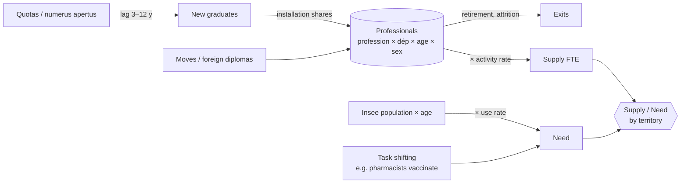

# Health workforce twin: where we are
Day 1 status · MMOPKSI excluding general practice · open data only

---

## The question we answer
*How many professionals of type X, in territory Y, in year T, under policy Z?*
e.g. specialists in Clermont-Ferrand (Puy-de-Dôme) in 2035 if pharmacists vaccinate.

We are judged on two things:
1. **Decision usefulness:** turn a lever, see the effect by territory, with a band.
2. **Forecast accuracy:** backtest error against a naive baseline.

---

## The model: stock-flow, by age and sex

Every policy lever acts on one arrow. That's how we cover the levers.
[Derivation](../derivations/workforce-projection-model.md)

---

## Finding: quotas can't move the 2035 specialist count
- Training a specialist takes ~10 years. 2026 → 2035 is 9 years.
- So **everyone who could be a new specialist by 2035 is already a student.**
- Nurses: a +10 % quota gives ≈ **+1.7 %** of stock by 2035 (derived; career length assumed).
- **The levers that matter by 2035** are retention, where graduates settle, foreign diplomas and task shifting.

---

## Data: what we have, what's missing
| Have | Missing |
|---|---|
| Students M/O/P by year × site × region, 2020–2025 | **The workforce stock**: blocks the model |
| SIES 2025: entry flows into health studies | Specialist vs GP split |
| Training cities with coordinates | Nursing / kiné / midwifery school data by region |
| | Population projections, use rates |

[Inventory](../explorations/data-inventory.md)

---

## Decisions needed
1. Demo horizon: **2035?**
2. Projection grain: **département** (region for small counts)?
3. Supply unit: headcount or full-time equivalent?
4. Is a Mistral model required by the organisers?
