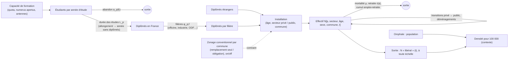

# Feuille de route : jumeau numérique des professions de santé « libérales »

> **v2.** Code et docs dans `v2/` ; la v1 (`sante/`, `app/`, `docs/lab/` à la racine) est figée et sert de référence.
> Décisions correspondantes : [decisions.md](docs/lab/decisions.md), entrées
> du 2026-11-14. Questions ouvertes et leur prix :
> [open.md](docs/lab/open.md).

## 1. Objectif

**Le projet.** Un projet de recherche quantitative. On simule des
**politiques publiques nationales**, chacune exprimée comme un réglage
d'hyperparamètres sourcés. On mesure leur effet à une date future *t*, avec
**2050 comme horizon de référence**, sur l'effectif « libéral » de cinq
professions :

| Sortie | Profession |
|---|---|
| N_SF(t) | maïeutique (sages-femmes) |
| N_CD(t) | odontologie (chirurgiens-dentistes) |
| N_PH(t) | pharmacie |
| N_MK(t) | masseurs-kinésithérapeutes |
| N_IDE(t) | soins infirmiers |

**Ce que « libéral » veut dire ici.** Le secteur privé, lucratif ou non.
- *Inclus :* libéraux et mixtes, pharmaciens adjoints salariés d'officine,
  salariés de cliniques privées et d'établissements privés non lucratifs,
  industrie, laboratoires privés.
- *Exclus :* tout employeur public (hôpital public, PMI, Éducation
  nationale, EHPAD publics, centres de santé municipaux).
- Les sources (RPPS, ameli) emploient « libéral » au sens d'exercice
  indépendant. On rappelle donc notre définition à chaque sortie.

**Échelles.** Les modèles tournent à tous les niveaux : commune, groupes de
communes, département, région, national. La régulation de l'installation
s'applique par commune, et le DG d'ARS doit avoir la visibilité maximale.

**Ce qui vient ensuite.**
- **Phase 2**, une fois la phase 1 terminée : cardiologie, dermatologie,
  ophtalmologie. Appui : rapport HCAAM *Trois scénarios pour une réforme des
  dépassements d'honoraires des médecins*.
- **Couche ultérieure :** sélection des paramètres par persona (ARS/DG,
  Administration, élu·e) et aide à la décision sur les sorties.
  L'application `app/` reste gelée jusque-là. Le cadrage actuel est
  celui de la recherche quantitative ; l'outil viendra ensuite.

**Principes non négociables**
- **Démarche scientifique.** Chaque méthode et chaque résultat est :
  - reproductible : commande, données, millésime, version du code ;
  - falsifiable : le test qui peut échouer est écrit *avant* de le lancer ;
  - explicable et interprétable.
- **Aucune boîte noire.** Chaque paramètre a un sens, une source, une unité
  et une incertitude.
- **Code en briques (plug-ins).** Chaque mécanisme est un module qu'on
  ajoute, retire ou remplace sans toucher aux autres.
- **Repris de l'existant :**
  - données ouvertes uniquement, chaque entrée cite son jeu de données et
    son millésime ;
  - lexique neutre ([lexicon.md](../docs/lab/lexicon.md)) ;
  - plusieurs estimateurs comparés plutôt qu'un chiffre unique.

## 2. Modèles de référence dont on reprend les hyperparamètres

| Modèle | Ce qu'il projette | Hyperparamètres (cibles des politiques) |
|---|---|---|
| **Omphale** (Insee) | la population | fécondité · espérance de vie à la naissance · solde migratoire |
| **Hippocrate** (DREES) | les médecins | départs à la retraite · mortalité · âge à l'installation · entrées nationales annuelles, elles-mêmes = formés en France (décalés de la durée des études, dont 3–4 ans d'internat) + diplômés étrangers |
| **DREES, Dossiers n°76 (2021)** | dentistes, sages-femmes, pharmaciens, jusqu'en 2050 | modèle par composantes (âge × sexe × mode d'exercice) : cessation, transition de mode d'exercice, reprise, entrées décalées, diplômés étrangers. Voir [l'exploration](../docs/lab/explorations/drees-projections-and-apl.md) |

- **Communs à toutes les cohortes :** mortalité, retraite, âge à
  l'installation (publiés par les ordres).
  - ⚑ La retraite n'est **pas stationnaire** dans nos données. Une partie
    de l'écart vient des professionnels qui exercent après 65 ans :
    +1 527 pharmaciens en 2026, mesuré dans le [rapport sur les
    entrées](../docs/lab/reports/2026-11-13-pipeline-entries.md).
  - Elle reste donc un hyperparamètre, avec une tendance possible.
- **Propres à chaque profession :** capacité de formation, schéma d'études
  (durée, abandon, filières), régulation de l'installation.

## 3. Les flux à représenter, quelle que soit la méthode

Ce schéma décrit les **mécanismes** que les leviers doivent pouvoir
toucher. Ce n'est pas une méthode imposée. Le stock-flux actuel est le
**modèle de départ** ; l'axe 2 cherche mieux, tant que ce n'est pas une
boîte noire.

## 4. Axes de recherche

Chaque axe produit des **fiches** : un paramètre ou un mécanisme, avec sa
source, sa valeur, son unité, son millésime, son incertitude et la façon de
le mesurer. Chaque axe a un critère d'acceptation vérifiable.

### Axe 0 — Le jumeau numérique de l'offre de soins en France · *socle commun, prérequis des autres axes*
- **Rôle.** Le jumeau est **ce qui relie les axes**. Il est un objet
  unique, l'état de l'offre de soins, et chaque axe s'y branche :
  - l'axe 1 lui fournit des paramètres ;
  - l'axe 2 des modules de dynamique ;
  - l'axe 3 le teste ;
  - l'axe 4 l'alimente en données et en événements ;
  - l'axe 5 l'interroge.
- **Trois composants :**
  1. **L'état** : N[profession, secteur, âge, sexe, commune, t], plus le
     vivier en formation. Les années passées sont observées ; les années
     futures sont simulées.
  2. **Les modules de flux**, des plug-ins : formation, abandon, filières,
     installation, régulation, sorties, transitions. Chacun lit l'état,
     déclare ses paramètres sourcés et écrit des flux.
  3. **Le scénario** : un jeu d'hyperparamètres et d'événements datés. Une
     politique publique est un scénario.
- **Conséquence dérivée.** Le jumeau représente toute l'offre, **secteur
  public compris**, même si la sortie étudiée est le « libéral ». Deux
  raisons :
  - un entrant bloqué par la régulation peut partir vers le public ;
  - les transitions privé ↔ public sont un flux.

  Sans le public dans l'état, la conservation des effectifs serait violée.
- **Question.** Quelle interface commune pour que les axes avancent en
  parallèle ?
- **Point de départ.**
  - `sante/estimators.py` (`fit` / `predict` / `assumptions`) est un
    plug-in au niveau du modèle entier. Il faut descendre au niveau du flux :
    `Module(entrées, paramètres sourcés, sorties)` et un registre.
  - La proposition `Perturbation(slot, selector, profile)` est déjà dans
    decisions.md § Open.
  - Le contrat doit accepter des méthodes **autres que le stock-flux**.
- **Fait quand :**
  - le modèle actuel, réécrit en modules, reproduit `predict` à
    l'identique (écart 0) ;
  - ajouter un module ne modifie aucun autre fichier ;
  - la même sortie est agrégeable de la commune au national (les sommes
    tombent juste).
- **État (2026-11-14) : fait.** Le code est dans `v2/jumeau/`.
  - Les quatre critères sont mesurés à l'écart 0, et le recalcul d'un
    scénario prend 18 ms au département.
  - **Révisé après la revue adversariale :** dix critères (C1–C10),
    chacun capable d'échouer, passent tous. Les 4 défauts bloquants sont
    corrigés.
  - Voir le [rapport](docs/lab/reports/2026-11-14-jumeau-axe0.md) et la
    [décision](docs/lab/decisions.md) « Contrat du jumeau ».
  - Les axes 2 et 5 attendent une nouvelle revue (décision « Les axes 2
    et 5 attendent »).
  - Reste ouvert ([open.md](docs/lab/open.md)) : diplômés → entrées,
    taux du public, état communal projetable.

### Axe 1 — Nouveaux hyperparamètres sourcés et mesurables
- **Question.** Quelles spécificités manquent, par profession, avec quelle
  valeur et quelle source ?
- **Pistes :**
  1. **Régulation conventionnelle de l'installation** (SF, CD, MK, IDE ;
     accords entre syndicats et Assurance Maladie, renégociables).
     - D'après le [mémoire EHESP 2025](../Memoire123.pdf), § 1.4.3 et cartes
       27 à 30 :
       - en zone sur-dotée, conventionnement **seulement en remplacement
         d'un départ**. Pour le modèle : entrées ≤ sorties dans la zone.
         Ce n'est pas une « part libérale nulle » ;
       - en zone sous-dotée, **obligation temporaire d'exercice** (2 ans
         pour les dentistes).
     - Levier : activation ou désactivation par profession × liste de
       géocodes.
     - Inconnue à mesurer : où vont les entrants bloqués (autre commune,
       secteur public, abandon).
     - Indice déjà publié : l'IGAS observe une réduction des inégalités
       pour les IDE et les SF entre 2016 et 2019 (cité par le mémoire).
  2. **Filières en pharmacie** : officine, industrie, biologie, hôpital,
     etc. Source : rapports démographiques annuels de l'Ordre. Avec la
     définition « privé », la part qui compte est celle **hors employeur
     public**.
  3. **Spécialisation en odontologie** : ODF, chirurgie orale, médecine
     bucco-dentaire. Part annuelle, d'après l'Ordre.
  4. **Abandon en études infirmières** : il pourrait approcher 30 % par an,
     à vérifier. Source : enquête annuelle auprès des écoles de formation
     aux professions de santé (DREES), séries depuis les années 1980.
- **Point de départ.** [levers.md](../docs/lab/levers.md) (32 leviers) et les
  questions chiffrées de [open.md](docs/lab/open.md).
- **Fait quand :** chaque piste a une fiche avec une valeur, une source
  primaire, un millésime et une incertitude. Une piste sans source mesurable
  est classée « non mesurable », jamais inventée.

### Axe 2 — Méthodes de modélisation plus performantes (pas seulement le stock-flux)
- **Question.** Quelles méthodes prévoient mieux tout en restant
  interprétables ? Le stock-flux n'est pas imposé : c'est le modèle de
  départ à battre.
- **Base mesurée sur le banc** ([K1](../docs/lab/reports/2026-11-13-k1-backtest.md)),
  sur l'ancien périmètre :
  - par département, 8,08 % de MAPE pour le stock-flux à taux locaux,
    contre 8,68 % pour la tendance ;
  - au niveau national, −10 à −12 % à 8 ans pour les dentistes avec des
    entrées plates.
- **Méthodes candidates** (interprétables par construction ; à départager
  avec `derive-ansatz` puis le banc) :
  - **Microsimulation individuelle**, comme la DREES pour les médecins.
    Chaque règle est lisible et la régulation par commune s'y exprime
    naturellement.
  - **Modèles bayésiens hiérarchiques et espace-état.** Les communes
    empruntent de la force au département et à la région (estimation sur
    petits domaines), avec une incertitude propre. Utile contre le bruit
    des petits effectifs.
  - **Choix discret de l'installation** (logit sur les attributs des
    communes). C'est le mécanisme explicite derrière la répartition
    territoriale, qui domine l'erreur par département d'après K1.
  - **Dynamique des systèmes avec rétroaction** (H3 de la
    [dérivation](../docs/lab/derivations/stress-tests-and-feedback.md)).
  - **Modèles additifs (GAM) et modèles spatiaux (CAR)** pour les taux,
    avec des effets lisibles.
  - **Pistes déjà identifiées dans le stock-flux :** rétention après
    60 ans en tendance, diplômés étrangers, transitions privé ↔ public.
- **Exclu :** toute méthode dont on ne peut pas expliquer le paramètre
  qu'un levier modifie.
- **Fait quand :** une méthode bat la meilleure référence sur le banc, avec
  un protocole fixé avant de voir les résultats (axe 3).
- **État (2026-11-14) : banc lancé.** Cinq variantes ont été
  pré-inscrites avant le banc.
  - Le shrinkage hiérarchique dép → région → national bat la référence
    stock-flux : 8,57 % contre 8,68 % de MAPE dép. à h = 5, Δ −0,11 pt,
    IC 95 % [−0,21 ; −0,02] au privé, reproduit sur l'ancien périmètre.
  - Âges simples à égalité. Rétention des 60 ans et plus en tendance
    pire.
  - Voir le [rapport](docs/lab/reports/2026-11-14-axe2-methodes.md).

### Axe 3 — Méthodologie de validation
- **Question.** Comment montrer qu'un modèle et un levier sont justes,
  jusqu'en 2050 ?
- **Quatre niveaux :**
  1. **Prévision, jusqu'à environ 10 ans.** Backtest sur plusieurs
     origines, contre des références naïves. Le protocole est
     pré-enregistré, pour éviter le biais de sélection relevé dans K1.
  2. **Long terme (2050), qui ne se backteste pas.** Les données vont de
     2012 à 2026. On valide donc :
     - par reproduction du tendanciel DREES n°76 à 2050 avec ses
       hypothèses ;
     - par les cas limites (persistance quand h → 0, équilibre N* = Q·C
       quand h → ∞).
  3. **Effet des leviers.** Un backtest ne valide pas un levier. On le
     valide par une expérience naturelle : zonage infirmier de 2012,
     régulation des kinés, en différence de différences entre communes
     régulées et non régulées.
  4. **Échelle fine.** Erreur par taille de commune. On rend publique la
     taille minimale en dessous de laquelle une projection communale n'est
     pas affichée sans bande.
- **Fait quand :** un protocole écrit par niveau, et au moins un levier
  validé de bout en bout.

### Axe 4 — Enrichir les jeux de données
- **Question.** Quelles séries et quels événements expliquent les ruptures ?
- **Exemples :**
  - les nouvelles antennes d'odontologie (8 récemment) ;
  - l'année sans diplômées sages-femmes, due à l'allongement des études ;
  - le saut d'inscrits en 2025, non expliqué ;
  - **la séparation public / privé** dans « salarié hospitalier » et
    « autre salarié ».
- **Pourquoi la séparation public / privé est prioritaire.** Sans elle, la
  sortie « libéral » 2026 n'est connue qu'en fourchette :
  - SF : de 12 475 à 26 428 ;
  - PH : de 65 344 à 75 335.
- **Livrables :**
  - un **registre d'événements daté et sourcé** (réforme, date d'effet,
    profession, flux touché), que le modèle lit comme une entrée ;
  - le **zonage par commune × profession** en géocodes.
- **Frontière avec l'axe 1.** L'axe 1 produit des *paramètres* (mécanisme et
  valeur). L'axe 4 produit des *séries et des événements observés*.

### Axe 5 — Sensibilité et incertitude
- **Question.** Quels hyperparamètres déplacent vraiment N « libéral »(2050)
  ? De combien, et avec quelle bande ?
- **Méthode.** Criblage de Morris, puis indices de Sobol. Interprétable par
  construction.
- **Pourquoi.** Elle **met un prix sur l'axe 1** : inutile de sourcer
  finement un paramètre qui ne bouge pas la sortie. Elle donne aussi les
  bandes à 2050, faute de backtest à cet horizon.
- **Fait quand :** les paramètres sont classés par profession et par
  horizon (2030, 2040, 2050), et l'axe 1 est priorisé en conséquence.

## 5. Phase 2 — cardiologie, dermatologie, ophtalmologie
On reprend le même contrat de modules et on ajoute les paramètres propres à
ces spécialités :
- postes d'internat par DES ;
- secteur 1 / 2 ;
- dépassements d'honoraires, d'après les scénarios HCAAM.

**Démarrage :** quand les axes 0 à 3 sont terminés pour au moins une
profession de la phase 1.

## 6. Ce qui est repris de l'existant
- **Données :**
  - RPPS 2012–2026 (dép × âge × sexe × mode) ;
  - Omphale 2018–2070 ;
  - ameli 2010–2025 ;
  - CartoSanté par commune ;
  - inscrits en formation ;
  - infirmiers salariés ajustés : leur partie privée revient dans le
    périmètre.
- **Code :**
  - `sante/` : estimateurs, banc `sante/backtest.py`, filière
    `sante/pipeline.py` ;
  - `app/`, gelée.
- **Raisonnement :**
  - dérivations du modèle stock-flux, stress tests et rétroaction ;
  - registre de 32 leviers.
- **Résultats K1 et filière :** mesurés sur l'**ancien périmètre** (libéral
  + mixte). Le banc est à relancer sur le nouveau.

## 6 bis. Livrable de chaque axe : un prétirage arXiv (2026-11-14)
- Chaque axe (0 à 5) rédige un article de recherche au format prétirage
  arXiv dans `v2/papers/axeN-<sujet>/`, à partir de `v2/papers/template/`.
- Plan imposé : introduction, travaux existants, données, méthode,
  résultats, validation et menaces à la validité, reproductibilité,
  conclusion.
- Chaque nombre est étiqueté (mesuré, dérivé, supposé) et la bibliographie
  ne contient que des références vérifiées.

## 7. Ordre de travail (validé le 2026-11-14)
1. **Tout de suite, en parallèle :**
   - axe 0, le jumeau ;
   - axe 1, les fiches de paramètres ;
   - axe 3, les protocoles de validation ;
   - axe 4, les données, en commençant par la séparation public / privé.
2. **Quand le contrat du jumeau (axe 0) tourne :** axe 2 (méthodes) et
   axe 5 (sensibilité). L'axe 5 sert à prioriser l'axe 1.
3. **Format commun des fiches** (axes 1 et 4) : `docs/lab/fiches/<id>.md`.
   Le frontmatter contient :
   - `parametre`, `profession`, `module` ;
   - `valeur`, `unite`, `incertitude` ;
   - `source`, `millesime` ;
   - `statut` (mesuré / sourcé / supposé / non mesurable).
4. **Partage du dépôt** (aucun commit pour l'instant) : chaque session ne
   touche que ses fichiers et ne commite rien. Tout le nouveau travail va
   dans `v2/` ; `sante/` et `app/` (v1) sont en lecture seule. L'axe 0
   possède le code du jumeau.
