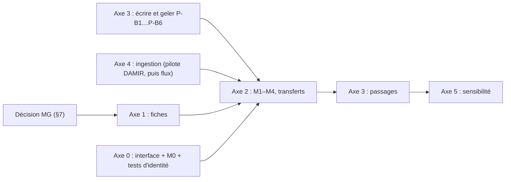

# Module de besoin : plan de construction par axes

**ETA, temps Claude :** ~12 h 30 au jugé ; **~6 h 20 après correction** (facteur médian ×0,51 du journal `eta.py`,
n = 93 ; plage ×0,16–×3,37, soit 2 h–42 h).
- **Temps machine en plus :** téléchargement et filtrage d'Open DAMIR, **~35–47 Go** compressés, soit 37 à 49 fichiers
  mensuels (dérivé : ~0,95 Go par mois, mesuré par en-tête HTTP). Le premier chiffre (~80 Go) était faux : les années
  prévues faisaient ~100 Go. La fenêtre a été réduite le 2026-11-15 (registre). Débit inconnu : on chronomètre **un pilote d'un mois** avant de lancer le reste.
- **Distancier OSRM :** temps machine inconnu, pilote d'abord.
- **Exclut** le temps d'attente de l'utilisateur·rice.

**Portée en une ligne :** construire derrière une interface commune les estimateurs de besoin M0–M4 et les transferts
de tâches de la [dérivation](2026-11-15-besoin-derivation.md). Ils produisent un indice de couverture indexé à 2026, de
la commune au national, sans modifier la projection des effectifs.

**Hors périmètre (non-objectifs nommés) :**
- une rétroaction du besoin sur l'offre (N9 : effet nul) ;
- les prix et le reste à charge ;
- la dérive du recours par âge (L31) ;
- une projection de l'offre en médecine générale, quelle que soit l'option retenue au §7 de la dérivation ;
- les spécialistes comme sortie (phase 2) ;
- l'interface (couche ultérieure ; seule une sortie d'API est prévue).

**Prérequis :** la décision de périmètre sur la médecine générale (dérivation §7). Sans elle, l'axe 1 ne sait pas
s'il fiche `B_MG`.

## Axe 0 — Module dans le jumeau · ~1 h 30 (jugé)
- **Livrable.** `v2/besoin/` :
  - une interface `NeedEstimator` (`fit` / `predict(pop, état) → B[p, territoire, t]` / `assumptions`), sur le modèle
    de `v2/sante/estimators.py` ;
  - un module de jumeau qui lit l'état et la population et écrit `B` et `C`, sans toucher aux effectifs ;
  - une sortie d'API `besoin`, `couverture`, `couverture_base`.
- **Critères d'acceptation (chacun peut échouer) :**
  1. M0 : `C = densité / densité₂₀₂₆` à 10⁻⁹ près.
  2. Transferts à 0 : effectifs et densités identiques bit à bit au commit de référence ; `jumeau.check` 18/18.
  3. Additivité : `Σ_communes B = B_département = …` à 10⁻⁹ près relatif. C s'agrège par sommes de numérateurs et de
     dénominateurs, testé.
  4. Conservation des transferts : `ΣB' − ΣB = s·a·B_A·(k−1) + m` à 10⁻⁶ près.
  5. Latence : < 5 ms ajoutées au département ; carte < 150 ms au 95ᵉ centile, n ≥ 30, mesuré.
  6. Ajouter un estimateur ne modifie aucun autre fichier.
- **Protocole.** Aucun : ce sont des tests d'identité, pas des hypothèses.

## Axe 1 — Hyperparamètres sourcés · ~1 h 30
- **Livrable.** Une fiche par paramètre dans `v2/docs/lab/fiches/` :
  - `ω_a(p)` : poids APL DCIR 2022, 19 tranches, IDE, MK, CD, SF ;
  - `r̄(p)` et profil pharmaciens : DAMIR ;
  - `q_p` : actes ou honoraires par ETP ;
  - pour chaque transfert : `a`, `k`, `s_∞`, `τ`, `m` ;
  - `n_grossesse` pour les SF (texte du Code de la santé publique, à lire) ;
  - si l'option O2 est retenue : `B_MG` comme source.
- **Critère d'acceptation.** Chaque fiche porte une valeur, une source primaire lue, un millésime et une incertitude,
  ou bien « supposé » ou « non mesurable ». D'après l'exploration, on attend :
  - **L23** : `a` et `s(t)` sourcés, `k` supposé ;
  - **tension / diabète et L25** : non mesurables ;
  - **L27** : partiel.

  Aucune valeur sans étiquette. La relecture contradictoire suit la procédure de l'axe 1 du 2026-11-15 (lecteur puis
  vérificateur).
- **Protocole.** Aucun. La relecture tient lieu de contrôle.

## Axe 2 — Méthodes · ~4 h
- **Livrable.** Les estimateurs M1, M2 (saturation et frontière), M3 (prévalence × actes), M4 (2SFCA paramétré DREES,
  composable avec M1, M2, M3) et le module de transferts, chacun derrière `NeedEstimator`.
- **Critères d'acceptation :**
  - chaque estimateur reproduit les cas limites de la dérivation (§4) en test automatique :
    - profil plat ⇒ M1 = M0 ;
    - rayon 0 ⇒ M4 = densité de la commune ;
    - rayon ∞ ⇒ M4 = densité nationale ;
    - `Σ_i P_i A_i = Σ_j S_j` à 10⁻⁹ près ;
    - offre nulle ⇒ M2 et M3 > 0 ;
  - les tests d'abandon P-B1 à P-B3 sont lancés **après** le gel. Un ansatz tué est retiré du service, mais son code
    et son verdict restent.
- **Peut se découper :** M4 et le distancier forment une sous-session à part (fichiers disjoints).

## Axe 3 — Validation · ~1 h (protocoles) + ~1 h 30 (passages)
- **Livrable.** Six protocoles pré-enregistrés (P-B1 à P-B6, dérivation §8) dans `v2/validation/preregistered/`. Ils
  sont écrits et gelés **avant** que l'axe 4 ne calcule la moindre relation recours ~ offre.
- **Gel hors de git :**
  - empreinte SHA-256 de la copie gelée ;
  - jeton OpenTimestamps (`.ots`) et jeton RFC 3161 d'une autorité publique (`.tsr`), commités ;
  - calcul lancé seulement après réception du jeton ;
  - le rapport cite l'heure du jeton.

  Seule l'empreinte part à l'extérieur, et l'accord est demandé au moment du gel.
- **Cible externe : reproduire l'APL DREES 2024** pour IDE, MK, SF et CD (P-B4) :
  - entrées : état 2022 et population 2022 ;
  - succès : Spearman ≥ 0,90 et erreur absolue médiane ≤ 15 % ;
  - M4 doit battre de ≥ 0,05 en Spearman deux références naïves : la densité de la commune et la densité du bassin
    de vie ;
  - les seuils sont supposés et figés au gel.
- **Backtest contre une référence naïve (P-B5)** :
  - comparaison : recours 2016 → 2025, M1 contre la persistance du recours par habitant ;
  - mesure : MAPE départementale sur la patientèle ;
  - critère : au moins 3 professions sur 5, avec un IC par bootstrap des départements.
- **Expérience naturelle (P-B6)** : différence de différences sur l'expérimentation de 2017 en officine, dans six
  régions, pour mesurer `s(t)` et `m`.
- **Multiplicité.** Correction de Bonferroni sur les tests par profession à l'intérieur de chaque protocole,
  déclarée d'avance. C'est une menace relevée par le rapport technique.

## Axe 4 — Données · ~2 h de Claude + temps machine
- **Livrable.** Un module d'ingestion par source dans `v2/besoin/donnees/`. Les tables traitées passent dans le
  manifeste, avec les contrôles de totaux :
  - **DAMIR** : filtrage en flux mois par mois ; on ne garde que les agrégats région × âge × sexe × `PSE_ACT_SNDS` ×
    `PRS_NAT` utiles ; les fichiers bruts sont supprimés après agrégation et jamais commités ;
    - profils : 2025, et 2024 pour la stabilité (12 à 24 fichiers) ;
    - P-B6 : mois de campagne d'octobre à février, saisons 2015-16 à 2019-20 (~25 fichiers). Pas avant 2015 : les
      9 ZEAT d'avant 2015 ne recoupent pas les régions. Pas après février 2020 : le COVID ;
    - pas d'API de requête : téléchargement fichier par fichier par la page `download.php` (jeton), vérifié le
      2026-11-15 ;
    - pilote d'un mois chronométré d'abord ;
  - pathologies (effectifs, dépenses) ;
  - patientèle ;
  - honoraires ;
  - APL 2022–2024 ;
  - Open Medic J07BB ;
  - IQVIA ;
  - **distancier** : OSRM sur l'extrait OSM France, paires à 30 min au plus. Repli vol d'oiseau en attendant.
- **Critères d'acceptation :**
  - les totaux nationaux reconstruits égalent les totaux publiés à 0,5 % près, par profession et par année :
    - DAMIR contre le total inter-régimes publié ;
    - pathologies contre la somme des départements ;
  - la licence est inscrite dans le manifeste pour chaque table ;
  - **les tables dérivées de jeux ODbL portent l'ODbL**, ou restent hors du dépôt, selon la décision de licence
    (registre § Open) ;
  - DOM : déclarés hors de M4 si l'extrait OSM est métropolitain.
- **Contrainte d'ordre.** L'axe 4 ingère et contrôle les totaux. Il ne croise pas recours et offre avant le gel de
  l'axe 3.

## Axe 5 — Sensibilité · ~1 h
- **Livrable.** Une décomposition de la variance de `C(p, T, 2050)` selon quatre sources :
  - le choix de l'ansatz de besoin, parmi ceux qui survivent ;
  - le scénario Omphale (central, bas, haut) ;
  - l'incertitude de l'offre (tirages de C1) ;
  - les paramètres de transfert dans leurs plages sourcées ou supposées.
- **Critères d'acceptation.**
  - On publie le rapport « effet de la politique / dispersion due au choix du modèle de besoin », par profession, sur
    le modèle du ratio de l'axe 5 de l'offre.
  - Si le choix du modèle de besoin pèse plus que la politique, l'indice de couverture est affiché comme une
    **fourchette entre ansätze**, jamais comme un seul chiffre.
- **Protocole.** Le seuil de lecture (ratio < 1 ⇒ « non distinguable ») est gelé avec ceux de l'axe 3.

## Ordre et parallélisme

- **Vague 1, quatre sous-sessions parallèles** (fichiers disjoints) :
  - axe 3, protocoles : `v2/validation/preregistered/` ;
  - axe 4, données : `v2/besoin/donnees/` et `v2/data/` ;
  - axe 1, fiches : `v2/docs/lab/fiches/` ;
  - axe 0, interface : `v2/besoin/*.py` hors `donnees/`.

  Chacune met à jour le registre seulement en ajout, et la fusion se fait par la session qui les lance.
- **Vague 2, deux sous-sessions** :
  - M1–M3 et transferts ;
  - M4 et distancier.
- **Vague 3, en série** : passages de l'axe 3, puis axe 5.

## Ce qui prouverait que ce plan a tort
- **P-B1 et P-B3 abandonnent l'âge et la morbidité pour toutes les professions.** Le module se réduit alors à M0 et aux
  transferts, et la moitié de l'axe 2 est inutile. P-B1 coûte 30 min : on peut le lancer **en premier**, dès le gel,
  avant d'investir dans M2–M4.
- **Le pilote DAMIR montre un débit trop faible** (au-delà de ~6 h de machine pour ~45 Go) : P-B6 est alors reporté, et
  `m` reste « supposé ».
- **La décision de licence interdit de commiter les tables dérivées ODbL** : la reproductibilité passe alors par un
  script de reconstruction, pas par des tables commitées.
