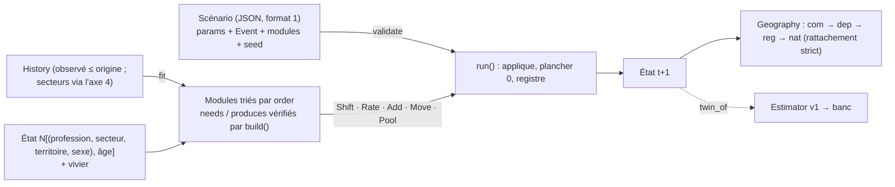

# Jumeau numérique, axe 0 : contrat, réécriture du stock-flux, critères qui peuvent échouer

> **Headline :**
> - **Critères.** 10 critères d'acceptation sur 10 passent (C1 à C10).
>   Chacun peut échouer : la colonne « avant » donne la valeur mesurée par
>   la [revue adversariale](2026-11-14-revue-adversariale-axe0.md) sur le
>   code d'origine, et deux mutations le vérifient.
> - **Reproduction.** Le stock-flux v1 est reproduit à l'écart **0,0**.
> - **Temps.** **17 ms** par scénario au département. À la taille
>   commune : **0,61 s** mesuré pour une profession sur 2 secteurs, et
>   environ 3,0 s extrapolé pour 5 professions.

*Version 2 de ce rapport : la première version annonçait 4 critères dont
3 étaient vrais par construction (revue adversariale).*

## Question
Le contrat de l'axe 0 (décisions « Contrat du jumeau » et « Corrections
du contrat », dans [decisions.md](../decisions.md)) doit permettre aux
axes 1 à 5 d'avancer en parallèle. Il doit répondre à quatre questions :
- porte-t-il le modèle existant à l'identique ?
- exécute-t-il les modules que le scénario déclare ?
- refuse-t-il les erreurs au lieu de les avaler ?
- conserve-t-il les effectifs ?

## Result
| # | Critère | Mesure (après) | Avant (revue) | Statut |
|---|---|---|---|---|
| C1 | Stock-flux v1 réécrit en modules = `predict` | écart **0,0** sur 140 comparaisons (5 variantes × banc K1 + origine récente → 2050) ; **0,0** sur 355 248 valeurs cellule × âge × année, 7 professions | (non contesté) | ✅ |
| C2 | Les modules du scénario passent par `twin_of` | régulation (kinés, 5 dép.) : privé dans les zones en 2050 **−8 552** ; un paramètre de régulation hors composition → erreur | écart 0,0 avec le tendanciel | ✅ |
| C3 | Plug-in sans toucher aux autres fichiers | module factice déposé dans un dossier temporaire, exécuté par `twin_of` : flux inscrit 4 040 = attendu ; tendanciel inchangé (0,0) ; inconnu avant dépôt → erreur | test hors `twin_of` | ✅ |
| C4 | La régulation déplace sans créer | public vide avec taux de repli : Δ total 2050 **−5,8·10⁻¹¹** sans plancher (+0,046 personne avec plancher) | **+822** kinés | ✅ |
| C5 | Dépendances déclarées | régulation sans `sorties`, double producteur, lecture non déclarée → 3 erreurs | résultat faux sans erreur | ✅ |
| C6 | Scénario validé et sérialisable | `sorties.decalage_retaite` → erreur ; opération ou axe inconnus → erreur ; aller-retour JSON : écart 0,0 | faute de frappe ignorée | ✅ |
| C7 | Leviers = vrai chemin v1 (`app/levers.project_flow`) | retraite + 1 an : 9·10⁻¹³ (effet +1,58 %) ; quotas × 1,1, L = 6 : 5·10⁻¹³ (effet +5,91 %), dentistes, 2027–2050 par département | quotas **+226** (un an trop tôt) | ✅ |
| C8 | Agrégation commune → national, rattachements stricts | interne 0 aux niveaux dép, région et national ; commune inconnue → erreur. **Écart externe** CartoSanté vs RPPS 2025 : dentistes **−2,8 %**, kinés **−5,4 %** (dont −2 084 dans le dép. 13 : Marseille absente) ; MAPE par dép. 4,2 % et 4,7 % | comparaison circulaire | ✅ (écart publié) |
| C9 | Aucun état partagé entre deux runs | diplômés 2028 : vivier × 1 = 4 253, vivier × 2 = 8 505 = instances neuves | `_intake` persistant | ✅ |
| C10 | Vieillissement à largeurs variables | fractions CartoSanté (0,067 ; 0,1 ; 0,2 ; 0,2 ; 0) ; total conservé | 1/5 codé en dur | ✅ |
| T | Temps de recalcul jusqu'en 2050 | **17 ms** : 7 professions au département. **0,30 s** : 1 profession, taille commune (70 094 cellules). **0,61 s** : 1 profession × 2 secteurs. **≈ 3,0 s** extrapolé à 5 × 2 | — | mesuré |

**Mutations (le test sait-il échouer ?).**
- Remettre s = 1 dans le secteur public fait échouer C4 : +838 personnes.
- Avancer les quotas d'un an fait échouer C7 : écart de 15 dentistes par
  département et par an.

**Régulation des kinés** (secteurs réels de l'axe 4, part privée
centrale ; zones 06, 13, 34, 66, 83, choisies **pour l'illustration**) :

| 2050 | Tendanciel | Régulation |
|---|---|---|
| privé dans les zones | 23 145 | 14 593 |
| public (tous dép.) | 14 362 | 22 435 |
| total | 175 145 | 174 665 |

Sur la période, 9 391 entrants sont déplacés vers le public, où ils
suivent les taux de sortie publics. Le total baisse de 480 parce que ces
taux diffèrent de ceux du privé : c'est un effet de la donnée, pas une
fuite (C4).

## How
- **Données :**
  - RPPS 2012–2026 via `sante.model.stock_table` (v1, oracle) ;
  - secteurs : `v2/data/processed/secteur_stock.parquet` (axe 4 :
    DREES 2026-07-02, FINESS 2026-05-04) ;
  - CartoSanté par commune, 2025 ;
  - inscrits DREES 2020–2025.
- **Méthode :**
  - l'ajustement reste `sante.model.fit_rates` ;
  - la projection passe par l'état et les modules ;
  - chaque critère est un test qui peut échouer, avec la valeur d'avant
    et deux mutations.
- **Commande :** `PYTHONPATH=v2 uv run python -m jumeau.check`. Environ
  45 s ; code de sortie 1 en cas d'échec.
- **Sorties :**
  [`v2/artifacts/a0_jumeau/results.json`](../../../artifacts/a0_jumeau/results.json),
  `reproduction.csv`, `check.log`.

## ⚑ What could make it wrong
- **C1 ne valide pas le modèle.** Il prouve que le contrat ne déforme
  rien. La précision reste celle de K1 : 8,08 % de MAPE, mesurée sur
  l'ancien périmètre.
- **Le plancher à 0 crée des personnes.** Il est hérité de la v1 et ajoute
  0,02 à 0,43 % de N(2050) selon la profession. Le registre le montre.
- **Le temps à la commune dépasse la cible.** 3,0 s sont extrapolés pour
  5 professions × 2 secteurs, au-dessus des 2 s supposés. La mesure porte
  sur des données répliquées : l'état communal réel n'existe pas encore.
- **La règle de repli du public est supposée.** Une cellule publique sans
  historique emprunte la rétention de la cellule privée de même
  (profession, territoire, sexe).
- **Les zones de régulation sont illustratives.** Le zonage réel est
  communal (axe 4), alors que l'état projeté est départemental.
- **L'écart CartoSanté / RPPS n'est pas corrigé.** Il atteint −5,4 % pour
  les kinés en 2025, et Marseille est absente. Une projection communale
  qui le reprendrait hériterait de ce biais.
- **La sensibilité à l'ordre des modules n'est pas mesurée.**

## → What it changes
- **Axes 2 et 5.** Les 4 défauts bloquants de la revue sont corrigés et
  testés (C2 à C6). La décision « Les axes 2 et 5 attendent » peut être
  levée **après une nouvelle revue**, comme elle le prévoit.
- **Axe 2.** Un module déclare ses `needs` et `produces` ; une méthode
  stochastique tire ses nombres dans `ctx.rng` (graine du scénario).
- **Axe 4.** `history.sector_table` consomme `secteur_stock.parquet`. Le
  zonage communal attend un état communal projetable.
- **Axe 3.** Les mutations C4 et C7 sont un modèle de test qui sait
  échouer.

## ? Next
| Item | Cost |
|---|---|
| Nouvelle revue adversariale (même workflow) | ~3 min machine |
| Recalcul communal réel, 5 professions × 2 secteurs ; vectoriser si > 2 s | ~20 min |
| État communal projetable (ventilation dép → commune, ou tranches CartoSanté) et correction de l'écart −5,4 % | ~45 min |
| Diplômés du vivier → filières → installation, à la place du flux ajusté | ~1 h |
| Plancher : convertir la troncature en sortie explicite | ~20 min |
| Sensibilité à l'ordre des modules | ~15 min |
