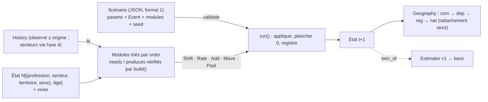

# Jumeau numérique, axe 0 : contrat, réécriture du stock-flux, critères qui peuvent échouer

> **Headline (version 5, leviers branchés) :**
> - **Critères.** 14 critères sur 14 passent. C14 couvre 12 leviers
>   répartis en 4 familles (former, attirer, installer, retenir). Chacune
>   des 9 mutations, qui retire l'effet d'un levier, fait échouer C14.
> - **Identité.** La composition `LEVIERS` aux valeurs par défaut est
>   identique au tendanciel (écart 0,0).
> - **Comparaisons aux chiffres cités :**
>   - capacité dentistes × 1,2 : 0 jusqu'en 2032, +0,73 % en 2033, +9,1 %
>     en 2050, contre ±12-13 % cités par DD76. L'exposition est plus
>     courte : 17 ans contre environ 25 ;
>   - IFSI, perte divisée par deux : diplômés × 1,196 et +15,6 % d'IDE
>     libéraux en 2050, contre ≈ +14 % cités par ER 1319 ;
>   - retraite + 1 an : kinés +1,55 %, IDE libéraux +3,02 %, contre
>     ≈ +1 % cité par la DREES (écart ouvert au ledger).
> - **Autres effets mesurés en 2050 :**
>   - diplômés étrangers × 2 : part de 0,24 chez les dentistes, +18,1 % ;
>   - départs précoces × 0,5 : +5,6 % ;
>   - quotas × 1,2 en Auvergne-Rhône-Alpes : +11,9 % dans la région,
>     0 ailleurs ;
>   - part des zones régulées 0 / 0,6 / 1 : 0 / 227 / 356 kinés déplacés
>     la première année.
> - **Temps.** 21 ms au département ; 0,49 s à la taille commune pour une
>   profession × 2 secteurs.
>
> **Headline (version 4, après la troisième revue et les défauts de l'axe 1) :**
> - **Critères.** 13 critères sur 13 passent (C1 à C13).
>   - La [troisième revue](2026-11-14-revue-adversariale-axe0-v3.md) ne
>     trouvait plus de défaut bloquant. Ses 4 défauts importants et ses 3
>     constats non vérifiés sont corrigés et couverts par C13.
>   - Chaque mutation fait échouer C13 : bornes, JSON, λ = Δ, blocage de
>     toutes les entrées, entrées négatives déplacées.
> - **Axe 1.** Ses défauts sourcés sont câblés et couverts par C12 :
>   - abandon IDE 1 − 0,718^(1/3) ≈ 0,105 par an (dérivé) ;
>   - cumul emploi-retraite par profession (COR 2016) ;
>   - θ = 0,80 (supposé) ;
>   - entrants bloqués répartis entre voisine, salariat et sortie, avec un
>     défaut supposé de 100 % voisine. **La régulation par défaut est donc
>     sans effet au département.**
> - **Temps.**
>   - 22 à 36 ms par scénario au département (deux runs, machine
>     partagée).
>   - À la taille commune : 1,36 s pour une profession × 2 secteurs,
>     contre 0,78 s en version 3. Le surcoût vient des calculs propres aux
>     tranches multiples ≥ 65 et des bornes vérifiées à l'exécution.
>   - Extrapolé à 5 professions : ≈ 6,8 s, bien au-dessus des 2 s visés.
>
> **Headline (version 3, après la seconde revue) :**
> - **Critères.** 11 critères sur 11 passent (C1 à C11). Les 4 défauts de
>   la [seconde revue](2026-11-14-revue-adversariale-axe0-v2.md) font
>   chacun échouer leur critère quand on les réintroduit (voir
>   « Mutations »).
> - **Retraite.** Levier B1 : séjour en 65+ allongé de +1,000, +2,000 et
>   +5,000 ans pour Δ = 1, 2 et 5 (avant : +1,31 an pour Δ = 1, infini à
>   partir de Δ = 5).
> - **Régulation.** Elle conserve le total dans l'état réel à 2 secteurs.
>
> *Version 2 :*
> - **Critères.** 10 critères d'acceptation sur 10 passent (C1 à C10).
>   Chacun peut échouer : la colonne « avant » donne la valeur mesurée par
>   la [revue adversariale](2026-11-14-revue-adversariale-axe0.md) sur le
>   code d'origine, et deux mutations le vérifient.
> - **Reproduction.** Le stock-flux v1 est reproduit à l'écart **0,0**.
> - **Temps.** **17 ms** par scénario au département. À la taille
>   commune : **0,61 s** mesuré pour une profession sur 2 secteurs, et
>   environ 3,0 s extrapolé pour 5 professions.

*Version 3 de ce rapport.*
- *La version 1 annonçait 4 critères, dont 3 étaient vrais par
  construction (première revue).*
- *La version 2 en annonçait 10. La seconde revue a trouvé 4 défauts
  qu'ils ne pouvaient pas voir :*
  - *le levier retraite comparé à une v1 qui porte le même défaut ;*
  - *une régulation qui faisait varier le total ;*
  - *un scénario qui écrasait la base ;*
  - *des sélecteurs non validés.*

## Question
Le contrat de l'axe 0 (décisions « Contrat du jumeau » et « Corrections
du contrat », dans [decisions.md](../decisions.md)) doit permettre aux
axes 1 à 5 d'avancer en parallèle. Il doit répondre à quatre questions :
- porte-t-il le modèle existant à l'identique ?
- exécute-t-il les modules que le scénario déclare ?
- refuse-t-il les erreurs au lieu de les avaler ?
- conserve-t-il les effectifs ?

## Result
| # | Critère | Mesure (après) | Avant (revue) | Statut |
|---|---|---|---|---|
| C1 | Stock-flux v1 réécrit en modules = `predict` | écart **0,0** sur 140 comparaisons (5 variantes × banc K1 + origine récente → 2050) ; **0,0** sur 355 248 valeurs cellule × âge × année, 7 professions | (non contesté) | ✅ |
| C2 | Régulation par `twin_of`, sans créer ni supprimer (état réel à 2 secteurs, axe 4) | privé des zones 2050 : kinés **−8 552**, dentistes **−4 398**. Δ total sans plancher : **−2,9·10⁻¹¹** et **0,0** (avec plancher : +0,05 et +0,20). Vers le public (option) : −474 et +254, publiés. Hors composition → erreur | v1 : écart 0,0 avec le tendanciel ; v2 : Δ total +254 / −474 | ✅ |
| C3 | Plug-in sans toucher aux autres fichiers | module factice déposé dans un dossier temporaire, exécuté par `twin_of` : flux inscrit 4 040 = attendu ; tendanciel inchangé (0,0) ; inconnu avant dépôt → erreur | test hors `twin_of` | ✅ |
| C4 | La régulation déplace sans créer (privé seul) | destination vide, taux de repli : Δ total 2050 **−2,9·10⁻¹¹** sans plancher (+0,046 avec plancher) | **+822** kinés | ✅ |
| C5 | Dépendances déclarées | régulation sans `sorties`, double producteur, lecture non déclarée → 3 erreurs. Flux Pool via `ctx.delta` → TypeError explicite ; via `ctx.pool_out` → 4 725 diplômés | résultat faux sans erreur ; KeyError brut sur Pool | ✅ |
| C6 | Scénario validé et sérialisable | `sorties.decalage_retaite`, opération ou axe inconnus → erreur. `{'profession': 'dentiste'}`, `{'territory': 6}` → erreur. Quotas × 110 → erreur (bornes [0, 3]). Aller-retour JSON : écart 0,0 | faute de frappe ignorée ; sélecteurs mal écrits → tendanciel ; × 110 → +5 085 033 | ✅ |
| C7 | Quotas = vrai chemin v1 ; retraite = séjour attendu (B1) | quotas × 1,1 (L = 6) : 4,5·10⁻¹³. Retraite : séjour en 65+ **+1,000 / +2,000 / +5,000 an** pour Δ = 1 / 2 / 5 (écart max 3,6·10⁻¹⁴). 60–64 × (1 − Δ/5) et 55–59 × (1 − Δ/10) exacts. Montée de 0,25 an par an. Effet en 2050 (dentistes, 65+ ouverte) : +1,60 % (Δ = 1), +3,22 % (Δ = 2) | quotas +226 ; séjour +1,31 an pour Δ = 1, infini pour Δ ≥ 5 | ✅ |
| C8 | Agrégation commune → national, rattachements stricts | interne 0 aux niveaux dép, région et national ; commune inconnue → erreur. **Écart externe** CartoSanté vs RPPS 2025 : dentistes **−2,8 %**, kinés **−5,4 %** (dont −2 084 dans le dép. 13 : Marseille absente) ; MAPE par dép. 4,2 % et 4,7 % | comparaison circulaire | ✅ (écart publié) |
| C9 | Aucun état partagé entre deux runs | diplômés 2028 : vivier × 1 = 4 253, vivier × 2 = 8 505 = instances neuves | `_intake` persistant | ✅ |
| C10 | Vieillissement à largeurs variables | fractions CartoSanté (0,067 ; 0,1 ; 0,2 ; 0,2 ; 0) ; total conservé | 1/5 codé en dur | ✅ |
| C11 | Le scénario se pose sur la base | variante filière : `trajectory(Scenario())` = `predict` = 102 987,2 ; quotas × 1,1 : **+6,53 %** | 82 374 ; quotas −15,2 % | ✅ |
| T | Temps de recalcul jusqu'en 2050 (mesure v3 : 21 ms au département ; 0,36 s, 0,78 s et ≈ 3,9 s à la taille commune) | **17 ms** : 7 professions au département. **0,30 s** : 1 profession, taille commune (70 094 cellules). **0,61 s** : 1 profession × 2 secteurs. **≈ 3,0 s** extrapolé à 5 × 2 | — | mesuré |

**Mutations, seconde revue.** On réintroduit chaque défaut dans le code
corrigé, puis on rejoue le critère (script dans le scratchpad de la
session) :
- **C7 échoue avec l'ancien masque retraite :** séjour +2,03 an,
  +5,41 ans et infini.
- **C2 échoue avec la destination `public` :** Δ total −474 et +254.
- **C11 échoue quand le scénario remplace la base :** 82 374 au lieu de
  102 987.
- **C6 échoue sans validation des valeurs :** 'dentiste', le
  territoire 6 et × 110 sont acceptés.

**Mutations, première revue.**
- Remettre s = 1 dans le secteur public fait échouer C4 : +838 personnes.
- Avancer les quotas d'un an fait échouer C7 : écart de 15 dentistes par
  département et par an.

**Régulation en version 3** (destination `bloques`, démographie du privé),
2050, sans plancher :

| Profession | Privé des zones | Bloqués | Δ total | Avec destination `public` |
|---|---|---|---|---|
| Kinés | −8 552 | +8 552 | −2,9·10⁻¹¹ | −474 |
| Dentistes | −4 398 | +4 398 | 0,0 | +254 |

**Régulation des kinés en version 2** (destination `public`, remplacée ;
secteurs réels de l'axe 4, part privée centrale ; zones 06, 13, 34, 66, 83
choisies **pour l'illustration**) :

| 2050 | Tendanciel | Régulation |
|---|---|---|
| privé dans les zones | 23 145 | 14 593 |
| public (tous dép.) | 14 362 | 22 435 |
| total | 175 145 | 174 665 |

Sur la période, 9 391 entrants sont déplacés vers le public, où ils
suivent les taux de sortie publics. Le total baisse de 480 parce que ces
taux diffèrent de ceux du privé : c'est un effet de la donnée, pas une
fuite (C4).

## How
- **Données :**
  - RPPS 2012–2026 via `sante.model.stock_table` (v1, oracle) ;
  - secteurs : `v2/data/processed/secteur_stock.parquet` (axe 4 :
    DREES 2026-07-02, FINESS 2026-05-04) ;
  - CartoSanté par commune, 2025 ;
  - inscrits DREES 2020–2025.
- **Méthode :**
  - l'ajustement reste `sante.model.fit_rates` ;
  - la projection passe par l'état et les modules ;
  - chaque critère est un test qui peut échouer, avec la valeur d'avant
    et deux mutations.
- **Commande :** `PYTHONPATH=v2 uv run python -m jumeau.check`. Environ
  45 s ; code de sortie 1 en cas d'échec.
- **Sorties :**
  [`v2/artifacts/a0_jumeau/results.json`](../../../artifacts/a0_jumeau/results.json),
  `reproduction.csv`, `check.log`.

## ⚑ What could make it wrong
- **La destination `bloques` est une hypothèse.** Elle conserve le total
  par construction. Si les entrants bloqués vont réellement dans le
  public, l'effet total vaut −474 kinés ou +254 dentistes : c'est la
  sensibilité à cette hypothèse.
- **Retraite sur des tranches fines.** Avec les tranches de la v1
  (65–69, 70–74, 75+), la formule e/(1+Δe) s'applique à chaque tranche
  de 65 ans et plus. Le séjour total au-delà de 65 ans n'y vaut plus
  exactement +Δ ; ce n'est pas mesuré. L'exactitude vaut pour la tranche
  ouverte 65+ (données de l'axe 4).
- **`fit_rates` suppose un vieillissement de 1/5** (constat de la seconde
  revue). Le calibrage des tranches communales reste à écrire.
- **Temps à la commune.** Environ 3,9 s extrapolés pour 5 professions ×
  2 secteurs, soit environ 30 % de plus qu'en version 2, à cause de la
  validation et de `prepare`. C'est au-dessus des 2 s supposés.
- **C1 ne valide pas le modèle.** Il prouve que le contrat ne déforme
  rien. La précision reste celle de K1 : 8,08 % de MAPE, mesurée sur
  l'ancien périmètre.
- **Le plancher à 0 crée des personnes.** Il est hérité de la v1 et ajoute
  0,02 à 0,43 % de N(2050) selon la profession. Le registre le montre.
- **Le temps à la commune dépasse la cible.** 3,0 s sont extrapolés pour
  5 professions × 2 secteurs, au-dessus des 2 s supposés. La mesure porte
  sur des données répliquées : l'état communal réel n'existe pas encore.
- **La règle de repli du public est supposée.** Une cellule publique sans
  historique emprunte la rétention de la cellule privée de même
  (profession, territoire, sexe).
- **Les zones de régulation sont illustratives.** Le zonage réel est
  communal (axe 4), alors que l'état projeté est départemental.
- **L'écart CartoSanté / RPPS n'est pas corrigé.** Il atteint −5,4 % pour
  les kinés en 2025, et Marseille est absente. Une projection communale
  qui le reprendrait hériterait de ce biais.
- **La sensibilité à l'ordre des modules n'est pas mesurée.**

## → What it changes
- **Axes 2 et 5.** Les 4 défauts bloquants de la revue sont corrigés et
  testés (C2 à C6). La décision « Les axes 2 et 5 attendent » peut être
  levée **après une nouvelle revue**, comme elle le prévoit.
- **Axe 2.** Un module déclare ses `needs` et `produces` ; une méthode
  stochastique tire ses nombres dans `ctx.rng` (graine du scénario).
- **Axe 4.** `history.sector_table` consomme `secteur_stock.parquet`. Le
  zonage communal attend un état communal projetable.
- **Axe 3.** Les mutations C4 et C7 sont un modèle de test qui sait
  échouer.

## ? Next
| Item | Cost |
|---|---|
| Troisième revue adversariale (même workflow) | ~3 min machine |
| Recalculer les chiffres retraite de l'axe 5 et du prototype avec B1 | ~10 min par axe |
| Recalcul communal réel, 5 professions × 2 secteurs ; vectoriser si > 2 s | ~20 min |
| État communal projetable (ventilation dép → commune, ou tranches CartoSanté) et correction de l'écart −5,4 % | ~45 min |
| Diplômés du vivier → filières → installation, à la place du flux ajusté | ~1 h |
| Plancher : convertir la troncature en sortie explicite | ~20 min |
| Sensibilité à l'ordre des modules | ~15 min |
